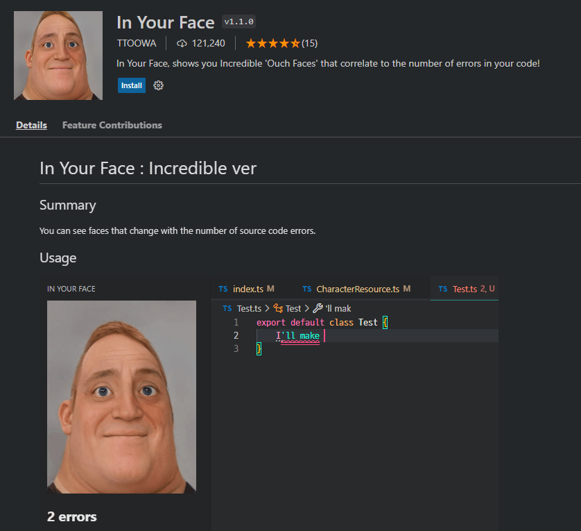

## Sharing and Contributing by Community

* Anyone can share interesting and useful extensions in "**Discussions**"

* Anyone can post interesting and useful extensions in "`share/README.md`" via **Pull Requests**

---

### In Your Face

* "In Your Face" is a VS Code extension that shows you Doom "Ouch Faces" relative to the number of bugs in your code! !

### Power Mode

* Power Mode adds animations like pop-ups, sparks and flickers as you type code to enhance the editing experience .

* You can also create your own custom effects .

<image src="https://user-images.githubusercontent.com/130225999/231623769-d86a09e8-1611-4b38-a6ba-c87aea9bd13f.png" width="60%" />

### AudioLens

* [AudioLens](https://marketplace.visualstudio.com/items?itemName=simzhou.audiolens) lets you listen to audio and inspect waveforms and spectrograms inside VS Code.
* Each channel has its own track with mute/solo controls. Select a region to listen to it, inspect RMS, sample peak and clipping, or export the selection as WAV.
* Adjust FFT size, window function and frequency scale, or open a supported audio path from a text file using the hover action.
* Free and open source under Apache-2.0: [source and documentation](https://github.com/SimZhou/vscode-audiolens).

