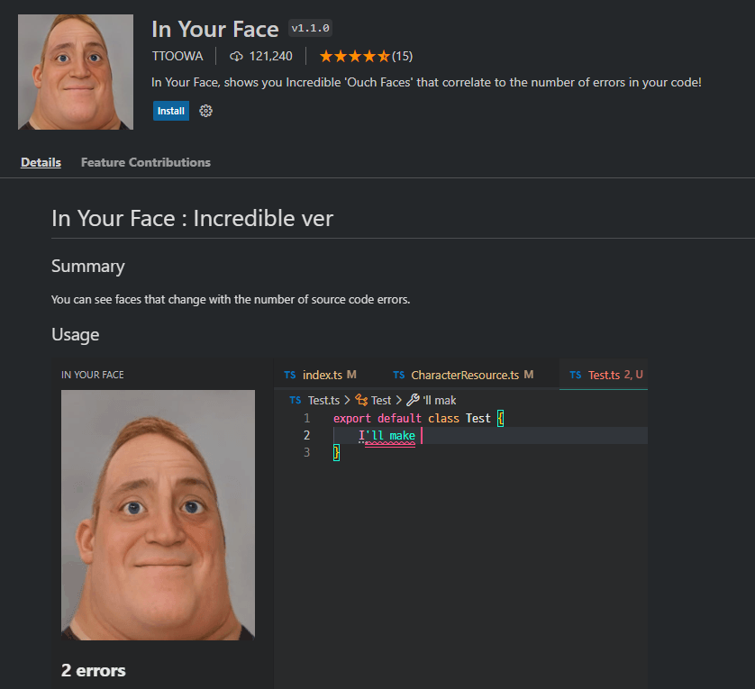

## Sharing and Contributing by Community

* Anyone can share interesting and useful extensions in "**Discussions**"

* Anyone can post interesting and useful extensions in "`share/README.md`" via **Pull Requests**

---

### In Your Face

* "In Your Face" is a VS Code extension that shows you Doom "Ouch Faces" relative to the number of bugs in your code! !

### Power Mode

* Power Mode adds animations like pop-ups, sparks and flickers as you type code to enhance the editing experience .

* You can also create your own custom effects .

<image src="https://user-images.githubusercontent.com/130225999/231623769-d86a09e8-1611-4b38-a6ba-c87aea9bd13f.png" width="60%" />

### Scigantic

* Scigantic is a VS Code and Cursor extension that searches a catalog of public research datasets and mounts one as a read-only local folder. Files are fetched on demand, so nothing is downloaded first.

* The mount is a normal path, so it works from the editor, the terminal, Python and R. It runs rclone to mount public S3, GCS and Azure Blob buckets, Zenodo records and public HTTP file trees.

* It is free and MIT licensed. Tested on macOS and Linux. Windows support is untested.

* Dataset catalog: <https://scigantic.com/explore>

* VS Code Marketplace: <https://marketplace.visualstudio.com/items?itemName=scigantic.scigantic-mount>
